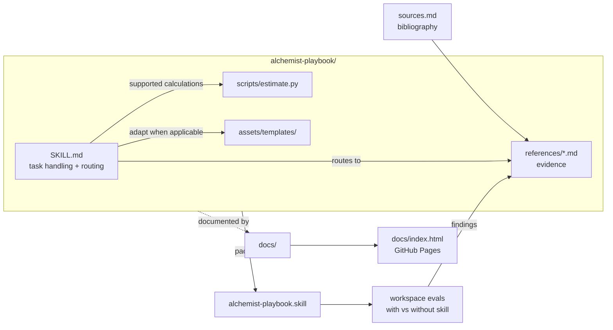

# Architecture

## Repo layout

```
AlchemistPlaybook/
├── alchemist-playbook/            # THE SKILL (source of the .skill archive)
│   ├── SKILL.md                   #   trigger, task handling, principles, routing, delivery guidance
│   ├── references/                #   evidence and task-specific baselines (see routing below)
│   ├── scripts/estimate.py        #   FLOPs / Chinchilla / batch / LR-ladder calculator
│   └── assets/templates/          #   8 ready-to-edit configs + experiment dashboard HTML
├── alchemist-playbook.skill       # packaged archive (build output — never edit directly)
├── alchemist-playbook-workspace/  # eval definitions + iteration results (with/without skill)
├── docs/                          # repo documentation (this tree)
│   ├── index.md                   #   agent road: master index
│   ├── index.html                 #   human road: interactive report (GitHub Pages root)
│   ├── decisions/                 #   append-only decision records
│   └── workflows/                 #   how to change things
├── scripts/check_docs.py          # deterministic doc/invariant checker
├── AGENTS.md                      # agent working contract (points here)
└── README.md                      # human landing page (points here)
```

## Component map



## How a question routes through the skill

1. The **trigger description** in SKILL.md frontmatter decides whether the
   skill activates (hyperparameters, run debugging, recipe design, eval
   suites, 煉丹/調參 …). Hard constraint: ≤ 1024 characters.
2. **Task handling and intake** recover relevant context from the user and
   available files. Missing facts prompt a question only when they affect
   the next decision; provisional work can continue.
3. The **routing table** maps the topic to one or more reference files
   (pretraining, post-training, stability, peft, speech, scaling-and-batch,
   diagnostics, evaluation, experiment-tracking, sources). Text-LLM baseline
   and cross-stage LR questions use `references/text-llm-baselines.md`.
4. `scripts/estimate.py` handles its supported calculations and LR lookups.
   Other calculations use explicit formulas and executable checks when
   available; an unexecuted estimate is labeled accordingly.
5. The deliverable follows the user's format and scope. Substantive tuning
   advice covers diagnosis, changes, evidence, and verification without
   requiring fixed headings. Config edits include relevant local validation.
   Reporting uses the existing tracker or an appropriate optional template.

These boundaries are recorded in
[decision 0006](decisions/0006-task-scoped-skill-guidance.md).

## Sync obligations (what must move together)

| When you change… | …you must also update |
| --- | --- |
| A reference file's scope or add/remove one | SKILL.md routing table (and trigger description if activation scope changed) |
| Any factual claim in a reference | `references/sources.md` entry backing it |
| Anything under `alchemist-playbook/` | repackage `alchemist-playbook.skill` ([workflows/release.md](workflows/release.md)) |
| Repo structure, conventions, or direction | the affected doc in `docs/` + [docs/index.md](index.md) + a decision record if directional |
| Headline stats (source count, eval results, decisions) | the `DATA` block in [docs/index.html](index.html) |

`scripts/check_docs.py` verifies the mechanical rows of this table.
