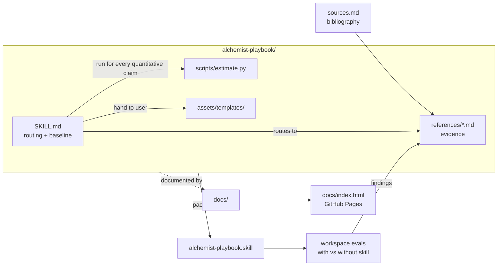

# Architecture

## Repo layout

```
AlchemistPlaybook/
├── alchemist-playbook/            # THE SKILL (source of the .skill archive)
│   ├── SKILL.md                   #   trigger description, principles, routing, baseline, output format
│   ├── references/                #   10 evidence files (one topic each; see routing below)
│   ├── scripts/estimate.py        #   FLOPs / Chinchilla / batch / LR-ladder calculator
│   └── assets/templates/          #   8 ready-to-edit configs + experiment dashboard HTML
├── alchemist-playbook.skill       # packaged archive (build output — never edit directly)
├── alchemist-playbook-workspace/  # eval definitions + iteration results (with/without skill)
├── docs/                          # repo documentation (this tree)
│   ├── index.md                   #   agent road: master index
│   ├── index.html                 #   human road: interactive report (GitHub Pages root)
│   ├── decisions/                 #   append-only decision records
│   └── workflows/                 #   how to change things
├── scripts/check_docs.py          # deterministic doc/invariant checker
├── AGENTS.md                      # agent working contract (points here)
└── README.md                      # human landing page (points here)
```

## Component map



## How a question routes through the skill

1. The **trigger description** in SKILL.md frontmatter decides whether the
   skill activates (hyperparameters, run debugging, recipe design, eval
   suites, 煉丹/調參 …). Hard constraint: ≤ 1024 characters.
2. The **intake checklist** collects task type, model, data, hardware,
   symptom, current config.
3. The **routing table** maps the topic to one or more reference files
   (pretraining, post-training, stability, peft, speech, scaling-and-batch,
   diagnostics, evaluation, experiment-tracking, sources).
4. `scripts/estimate.py` does all arithmetic (FLOPs, GPU-hours, Chinchilla,
   tokens/step, LR-ladder lookup) — the skill forbids mental math.
5. The answer follows the fixed **Diagnosis / Recipe / Evidence / Verify**
   format, with every value evidence-marked.

## Sync obligations (what must move together)

| When you change… | …you must also update |
| --- | --- |
| A reference file's scope or add/remove one | SKILL.md routing table (and trigger description if activation scope changed) |
| Any factual claim in a reference | `references/sources.md` entry backing it |
| Anything under `alchemist-playbook/` | repackage `alchemist-playbook.skill` ([workflows/release.md](workflows/release.md)) |
| Repo structure, conventions, or direction | the affected doc in `docs/` + [docs/index.md](index.md) + a decision record if directional |
| Headline stats (source count, eval results, decisions) | the `DATA` block in [docs/index.html](index.html) |

`scripts/check_docs.py` verifies the mechanical rows of this table.
